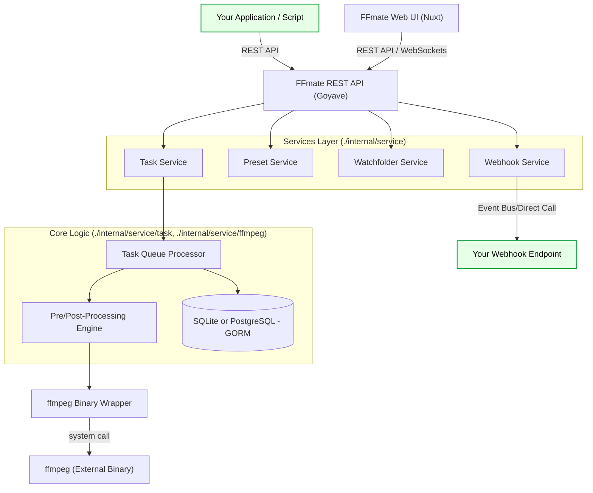

<p align="center">
  
</p>

<p align="center">
    <a href="https://github.com/welovemedia/ffmate/releases"></a>
    <a href="https://github.com/welovemedia/ffmate/actions"></a>
    <a href="https://coveralls.io/github/welovemedia/ffmate?branch=main"></a>
</p>

<p align="center">
    <a href="https://github.com/welovemedia/ffmate/blob/main/LICENSE"></a>
    <a href="https://pkg.go.dev/github.com/welovemedia/ffmate/v2"></a>
    <a href="https://discord.gg/NzfeHn37jT"></a>
</p>


## FFmate

FFmate is an automation layer on top of [FFmpeg](https://ffmpeg.org/). It simplifies transcoding and works as an extensible engine for custom media workflows. Applications and services can use FFmpeg through a REST API, event-driven webhooks, and pre- and post-processing scripts.

FFmate fits custom media processing pipelines, transcoding inside existing systems, and tools built around FFmpeg.

## Core features

- **REST API** – Submit and manage FFmpeg tasks programmatically
- **Web UI** – Monitor and control tasks in real time, no terminal required
- **Cluster Support** – Run multiple FFmate instances that share one PostgreSQL database for scaling and redundancy
- **Watchfolders** – Automatically process files dropped into a directory
- **Presets** – Built-in presets for common transcoding jobs, plus your own
- **Webhooks** – Get real-time notifications for task events
- **Wildcards** – Build output file names and folder structures from the input file, the date and other values
- **Pre/Post Processing** – Run custom scripts before or after each task
- **Built-in Queue** – Runs tasks by priority, with a limit on how many run at the same time

## Documentation

The documentation covers the API, the Web UI and real-world examples: [https://docs.ffmate.io](https://docs.ffmate.io)

## Getting started for developers

### Prerequisites

*   FFmpeg, installed and in `$PATH`.
*   Git, for cloning the repository.
*   A scripting language such as Python, Bash or Node.js for pre- and post-processing scripts.

To build from source, you also need:

*   Go 1.26.5 or newer.
*   Node.js and pnpm, to build the Web UI.

### Installation and setup

There are two options.

1.  Use a pre-compiled binary:
    *   Download the archive for your system from [GitHub Releases](https://github.com/welovemedia/ffmate/releases), for example `ffmate_Linux_x86_64.tar.gz`. Windows archives are `.zip`.
    *   Unpack it: `tar -xzf ffmate_Linux_x86_64.tar.gz`
    *   Optionally move the `ffmate` binary to a directory in your `$PATH`.
    *   Start FFmate: `./ffmate server`

2.  Build from source:
    *   Clone the repository with its Web UI submodule:
        ```bash
        git clone --recurse-submodules https://github.com/welovemedia/ffmate.git
        cd ffmate
        ```
    *   Build the Web UI. Without this step, `/ui` shows a placeholder page:
        ```bash
        make build+frontend
        ```
    *   Build the binary:
        ```bash
        go build -o ffmate main.go
        ```
    *   Start FFmate. For development, turn on debug logging:
        ```bash
        ./ffmate server --debug="debug:*"
        ```

The API is available at `http://localhost:3000/api/v1` and the Web UI at `http://localhost:3000/ui`.

### Extension points

*   Integrating with an existing application: submit tasks with `/api/v1/tasks` and use `/api/v1/webhooks` to get status updates back.
*   Custom logic around transcoding: set `scriptPath` and `sidecarPath` inside `preProcessing` or `postProcessing` in task and preset requests.
*   Custom dashboard or UI: the Web UI only uses the public REST API and a WebSocket at `/api/v1/ws`. The WebSocket sends live updates for tasks, presets, watchfolders, webhooks, FFmate instances and logs.
*   Ingestion workflows: create watchfolders with `/api/v1/watchfolders` and presets that run the custom processing.

## Internals and code structure

FFmate is a Go application.



Repository layout:

*   `main.go` sets the version and starts the CLI.
*   `cmd/` holds the CLI commands (`server`, `update`, `version`), built with Cobra.
*   `internal/` holds the application code. Other projects cannot import it.
    *   `controller/` has the HTTP handlers (Goyave) and the API routes, one package per feature. It also serves the Web UI, Swagger, health, metrics and the WebSocket.
    *   `service/` has the logic for each feature: tasks, presets, watchfolders, webhooks, clients, settings, updates, telemetry and the WebSocket. The task queue is in `service/task`, the `ffmpeg` wrapper in `service/ffmpeg`.
    *   `dto/` has the data transfer objects.
    *   `database/` has the GORM models (`model/`) and the repositories (`repository/`).
    *   `middleware/` has the middleware used by Goyave.
    *   `metrics/` has the Prometheus metrics served at `/metrics`.
    *   `cfg/`, `debug/`, `validate/` and `exception/` have configuration, debug logging, request validation and error handling.
    *   `dialect/` registers the SQLite driver (pure Go, no CGO).
    *   `docs/` has the generated Swagger documentation.
*   `ui/` is the [ffmate-ui](https://github.com/welovemedia/ffmate-ui) submodule. `make build+frontend` copies its build into `internal/controller/ui/ui-build/`, which is embedded in the binary.
*   `testsuite/` has the integration tests.
*   `go.mod` and `go.sum` are the Go module files.

Good places to start:

*   API handlers in `internal/controller/`: extend an endpoint or add one.
*   Business logic in `internal/service/`: change or add behaviour for a feature.
*   Task processing, FFmpeg handling and pre/post-processing in `internal/service/task/` and `internal/service/ffmpeg/`.
*   Web UI in `ui/`.

## Contributing

Contributions are welcome.

1.  Check the existing [GitHub Issues](https://github.com/welovemedia/ffmate/issues), or talk about your idea on Discord first.
2.  Fork the repository, clone your fork and build from source as described above.
3.  Create a branch, for example `git checkout -b feature/my-change`.
4.  Write the code and add tests where they make sense.
5.  Run `go fmt ./...`, `go vet ./...`, `make lint` and `make test`.
6.  Commit with a conventional message, for example `git commit -m 'feat: add my change'`.
7.  Push the branch and open a pull request against the `dev` branch of `welovemedia/ffmate` with a clear description of the change.

## Community and support

*   Discord: join the [FFmate community](https://discord.gg/NzfeHn37jT) to talk about extending FFmate, ask technical questions and share projects.
*   GitHub: report bugs and propose enhancements in [GitHub Issues](https://github.com/welovemedia/ffmate/issues).

## Sponsor

FFmate is created and maintained by developers and product managers at [MoovIT GmbH](https://moovit.de), a German systems integrator and software company that brings video production and IT together. MoovIT sponsors FFmate by letting the team build and maintain it during their working hours, alongside MoovIT's own projects.

## License

FFmate is licensed under the AGPL-3.0. See the [LICENSE](LICENSE) file for details.
